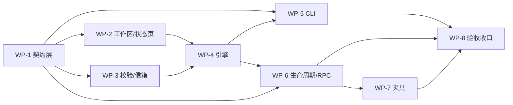

# I1.4 任务拆分与文件级契约（共享工作区 / 交接包校验 / CLI 命令集）

> 需求依据：`docs/iterations/iteration-4/requirement.md` **v26**（70 条 AC / M-1~M-12 / C-01~C-14 / BR-01~BR-46 / 附录 A~D；v26 为实现期回归口径裁决：白名单 8→9、两条禁令不变，并补齐 D-10 接缝枚举与 A-2 样例对齐）
> 上游实现：I1.1 单节点 + I1.2 编码闭环 + I1.3 文档闭环（`src/core/{orchestrator,advance,graph,state-machine,escalation,event-bus}.js`）
> 代码基线：HEAD `40c6fc0`，Node `v22.22.2`（darwin 25.6.0），零运行时依赖
> 测试基线：`node --test "test/**/*.test.js"` → **基线** 418 用例 / 409 pass / 8 fail / 1 skip（8 条既有失败白名单）；**实现期** 621 用例 / 610 pass / 10 fail / 1 skip（白名单扩为 9 条，新增 1 条负载相关 cancel 墙钟断言）。共 9 条为**既有基线失败白名单**，本迭代不修、不弱化、不改其断言；白名单之外新增失败 0、成功数 ≥ 409（当前实测 610，门槛不随规模上调）。判定口径见需求 NFR-06 基线说明 v26 与 §7.2

---

## 0. 定位、范围与退出标准

### 0.1 与 I1.3 的增量边界

I1.3 把"一条命令让单条闭环自己转起来"做完了，但引擎只做到"把字符串塞进 prompt"：交接包没有来源/轮次落盘、没有内容校验、没有持久化、失败只能升级；人工动作只有 `run/status/cancel/core stop`。

I1.4 把三件事一次性补齐，并且**只补这三件事**：

1. **工作区可共享**：`workspace/shared/`、`workspace/stage/<nodeId>/`、`workspace/status.md` 由核心建立并维护；
2. **交接包可信**：投递前按 D-3 校验字段/证据/越界/哈希/回流完整性，坏包"拒绝 + 升级"同一次 CAS；
3. **人工动作有入口**：持久化信箱与投递重试、`instance/attach/escalate/approve/handoff/workflow` 六组命令、审批编号、暂停语义。

与 I1.3 的关系是**加层不加分支**：不新增模板、不新增图引擎、不改 `driveGraph → finishGraphNode → advance → planAdvance` 主链。I1.3 的 `productPolicy`、`artifactPolicy`、下游门控、审核/判定路径全部原样保留。

### 0.2 范围内 / 范围外

| | 条目 |
|---|---|
| **范围内**（需求 §1.3 的 12 条） | 共享工作区三层可见域 + `status.md`；交接包 schema 校验；持久化信箱与 3 次投递尝试；`run/status` 补全；`instance status/log/graph`；`attach` 只读跟随；`escalate list/resolve`；`approve`；`handoff list/show`；`workflow pause/resume/abort`；升级人工裁决出边；兼容与可追溯 |
| **范围外** | 桌面端人工干预队列/通知（I1.11）；ACP 会话恢复与 daemon 重启续投（I1.8）；`attach` 注入输入（I1.8）；执行日志摘要/trace（I1.9）；角色注册表与角色实例图（I1.5）；声明式工作流定义（I1.6）；OS 级 ACL / worktree / 数据集快照（I1.7）；链式哈希/配额/签名（I1.12）；坏包自动修复；部分改写/diff 合并 |

`stage/` 的语义按 R-11：**本节点写自己的 stage，下游只读**；不实现"上游写下游目录"。

### 0.3 迭代退出标准（可量化）

1. **70 条 AC 全绿**：`node probe/acc4-f-run.mjs --all` → 通过 70 / 不通过 0 / 阻塞 0；每条证据落 `docs/iterations/iteration-4/evidence/`。
2. **回归无新增失败**：判定口径见**需求 NFR-06 基线说明（v26）**——`node --test "test/**/*.test.js"` 的失败集合在 §7.2 白名单（共 9 条，**按用例标题前缀匹配**）**之外的新增失败数 = 0**；白名单内用例**缺席不算回归**（性能/时序类在并行负载下可能通过），**成功数 ≥ 409**（当前实测 610，门槛不随规模上调），也**不得修改这 9 条用例来"变绿"**。
3. **架构扫描通过**：`node test/fixtures/purity-check.mjs --dirs src/core,src/daemon --forbid code-loop,developer,tester,coordinator,task-loop,researcher,writer,reviewer,研究员,撰写者,审核者` 退出 0、扫描文件数 > 0、零命中；`package.json` 无 `dependencies`。
4. **`single` 逐字基线不回归**：AC-03 / AC-54 的实例行、节点表、交接包行、升级块、退出码与 I1.1~I1.3 基线逐字一致（唯一授权变化是 M-11 的"挂起后下一步"一行）。
5. **单点风险全部有降级路径**：§7.1 的 9 条风险每条都有"触发条件 / 观测 / 处置"。

---

## 1. 技术选型（结论 + 被否决项 + 否决理由）

### 1.1 `status.md` 生成器归属与中文词表

**选定**：新增 `src/core/workspace.js` 承担"建目录 + 渲染 + 原子替换"三类 IO；新增 `src/core/status-text.js` 只放**核心侧状态/字段中文词表**（`CORE_TEXT`）。

- `statusDocText({ state, graph, workspaceDir })` 是**纯函数**：模板名取 `graph.title`、节点标题取图节点 `title`、角色取 `graph.nodes[].title`（不是 `roleId` 的英文），核心不持有任何模板名/角色名字面量。
- 原子性由新增的 `writeTextAtomic()` 提供（`src/persistence/atomic-write.js`，与 `writeJsonAtomic` 共用 tmp + fsync + rename 内核）。
- 词表一致性：`test/wp11/labels-sync.test.js` 做**逐词 deepEqual**——`CORE_TEXT.instance === INSTANCE_LABEL`、`CORE_TEXT.node === NODE_LABEL`、`CORE_TEXT.handoff === HANDOFF_LABEL`、`CORE_TEXT.escalation === ESCALATION_LABEL`、`CORE_TEXT.approval === APPROVAL_LABEL`，任何一侧改字都会红。

**否决**：
- (a) 放 `src/persistence/` —— `status.md` 要读图数据与状态语义（"当前节点""第 N 轮"），持久化层不该认识图；且 M-2 明确"核心侧生成器"。
- (b) 让 core `import '../cli/labels.js'`（I1.3 `review.js` 的口子）—— I1.4 新增 5 类词条（审批/暂停/已处理/重试/工作区状态），继续复用会把 CLI 的 `ERROR_TEMPLATE`、`USAGE` 一起拽进核心，违背 D-1"不 import CLI"。
- (c) 在 `status.md` 里写模板名常量 —— 违反 D-11.2 的 11 词扫描（含注释）。

**影响面**：`workspace.js` 是唯一写 `status.md` 的地方；`orchestrator.js` 只在快照落盘成功后调一次 `refreshStatusDoc`，失败只发事件、不回滚。

### 1.2 `handoff-schema.js` 的形态

**选定**：`src/core/handoff-schema.js`，**纯函数 + 注入 IO** 两层：

```js
validateHandoffFields(handoff, { graph })                       // 纯函数，无 IO
resolveEvidenceRef(ref, { workspaceDir, cwd, sourceNode, graph }) // 纯路径判定
validateHandoffEvidence(handoff, { workspaceDir, cwd, sourceNode, graph, fs, sha256Of })
validateHandoff(handoff, opts)                                   // 4→5→6 顺序组合
```

- 顺序严格按 D-3.2：`edge !== null` → 必填字段 → `edge.kind/createdAt` → 证据集合非空 → 逐条解析（存在/普通文件/非空/不越界/哈希）→ 回流完整性。
- 返回 `{ ok:true } | { ok:false, code, params }`，**不返回中文**；`detail` 由 `src/core/status-text.js` 的 `handoffInvalidDetail(code, params)` 拼（D-3.4 固定含"缺少证据引用"），保证"文案单源、码机读"。
- 证据基准按 C-07、**不按模板名分支**：`nodeDef.artifactPolicy ∈ {fixed-workspace, versioned-doc}` → 工作区基准；否则任务目录基准；`artifacts/` 前缀恒走工作区；绝对路径必须落在二者之一。
- "只产生一次升级"由调用方保证：`escalateState({ pendingHandoff })` 把"包置 `rejected` + 节点 `escalated` + 实例 `suspended` + 升级入列"写进**同一次 CAS**（见 §2.9 / §2.11）。

**否决**：
- (a) 校验器自己写盘/发事件 —— 会绕过 `transit()` 单入口与"先落盘再广播"，且在 DAEMON 侧无法保证一次 CAS。
- (b) 放 `src/core/advance.js` —— `advance` 是纯规划器（无 IO），加 `fs.stat` 会破坏它被 `planAdvance` 单测直接调用的能力。

**影响面**：`advanceLocked` 第 2 步、`test.handoff` 接缝、`AC-08~14/68/69` 全部只走这一个校验器。

### 1.3 信箱写入的原子性与事件顺序

**选定**：新增 `src/core/inbox.js`（等价于任务简报里的 `src/persistence/inbox.js`；D-1 的模块表已把它定在 core，且它只依赖 `paths.js` 的路径函数，不需要 store）。

- 顺序固定：`writeInbox()`（tmp + `writeJsonAtomic`）→ 成功 → `handoff.inboxed` 事件 → `adapter.prompt` → `handoff.delivered`。
- 写失败 → `INBOX_WRITE_FAILED` → **不投递**、不建会话、不发 `handoff.inboxed`；包 `created → rejected`（`delivery_failed`）+ 升级 + 挂起**同一次 CAS**。
- 每次尝试前重写同一文件（`deliveryAttempts` / `lastError` / `deliveredAt` 更新），文件名恒为 `<handoffId>.json`（C-08）。

**否决**：先投递再补写信箱（"投递成功即成功，信箱只是审计"）—— 违反 BR-10，且 AC-15 用 `handoff.inboxed` 早于 `handoff.delivered` 判定，事后补写必然红。

**影响面**：`.orch/inbox/<instanceId>/` 成为实例外的新目录；`handoff show` 的"信箱"行据其存在性打印，校验失败未写信箱时打印 `—`。

### 1.4 投递重试的实现

**选定**：重试**留在 `orchestrator.js` 的投递层**，新增内部函数 `deliverWithRetry(ctx, { handoff, sessionId, promptText })`：

- 3 次尝试，间隔 `200ms → 500ms`，用**可取消定时器**（`setTimeout` 句柄存 `ctx.deliveryTimer`，`cancel` 时 `clearTimeout`）。
- 每次重试前 `store.load()` 重检实例：`cancelled` / `halted` / 停用 → 清理定时器、不再尝试。
- `deliveryAttempts` 在**每次 `adapter.prompt` 之前**自增并落盘（首次成功 = 1）。
- 首次失败：`delivered → pending`（C-10），一次 CAS 写 `pendingAt/deliveryAttempts/lastError`，发 `handoff.pending`；后续每次失败同样更新并再发一条。
- 任一次成功：`pending → delivered({ attempt })`，写信箱 `deliveredAt`。
- 耗尽：`pending → expired`（写 `expiredAt`）+ 升级 `delivery_failed` + 挂起，**先落升级再 resolve `promptPromise`**（D-4.9），`finishGraphNode` 被 `isRunStopped` 短路，不二次升级。
- `NODE_ENV=test` 下 `test.delivery { action:'hold'|'release' }` 在"下一次重试前"插入确定性等待点，供 AC-61 构造"待投递中取消"。

**否决**：
- (a) 在 `finishGraphNode` 里重试 —— 那时 turn 已结束，`adapter.prompt` 的失败已被判成执行失败，错过"尚未收到 turn 内事件"的窗口。
- (b) 用 `setInterval` 轮询重试 —— 无法在取消时精确停止，AC-61 的 `attempts` 会继续增长。
- (c) 重试时重新 `dispatchInState` —— 违反 BR-14（会 +1 轮次、+1 会话、+1 派发）。

**影响面**：`ctx.promptPromise` 对外只暴露最终结果；`finishGraphNode` 在重试期间不得做 `hasSubmittedOutput` / `running → review`（D-4.9 的"节点保持 running"）。

### 1.5 审批状态的存放

**选定**：**实例级 `approvals[]` 数组**（不是独立文件）。

- 字段：`approvalId(APR-nnn)` / `instanceId` / `nodeId` / `sessionId` / `action` / `toolCallId` / `state(pending|approved|denied|withdrawn)` / `createdAt` / `resolvedAt` / `resolution(allow|deny|null)`。
- 与 `ctx.permission` 的关系：**内存 `respond` 仍是唯一能真正放行宿主的能力**；`approvals[]` 只是它的可落盘投影 + 编号。`allow/deny` 时先查 `activeRuns.get(instanceId)?.currentCtx?.permission`，拿到 `respond` 才迁移审批；拿不到 → `APPROVAL_SESSION_GONE`，**审批保持 `pending`**（AC-67 / D-5.9）。
- 创建与 `session.state='waiting_input'` + `pendingPermission` 在**同一次 CAS**落盘（D-5.4）。
- `APR-nnn` 复用 `escalation.nextEscalationId` 的同构实现（`nextApprovalId`，实例内单调、不复用），不跨实例共享。

**否决**：
- (a) 独立 `approvals.json` —— 取消/审批/会话三处状态无法一次 CAS；崩溃时会出现"会话在等、审批文件没有"的分裂。
- (b) 只存内存 —— AC-34 的跨实例歧义与 AC-35 的"取消作废"都必须可读盘，且 `status` 要打印全部历史审批。

**影响面**：`snapshotOf` / `store.projectItem` 必须投影 `approvals` 与 `pendingApprovals`；`applyCancel` 必须把 `pending` 全部置 `withdrawn`。

### 1.6 暂停的写序列（D-7.2 落地）

**选定**：**队列内取 expected** —— `store.save` 支持 `opts.expectedState` 为函数：

```js
// instance-store.js
const expected = typeof opts.expectedState === 'function'
  ? opts.expectedState(disk.state)   // 在 persist() 内、CAS 比较前一刻取值
  : opts.expectedState;
```

`pause/resume` 的实现：

1. **不取实例锁**（与 `cancelLive` 同理：`after_verdict` 接缝可能持锁等待）。
2. 入队一次 `store.save(instanceId, state, { expectedState: (disk) => ({ state: disk.state, halted: Boolean(disk.halted), rev: disk.rev ?? 0, paused: Boolean(disk.paused) }) })`；任务内先校验业务前置（`running` 且 `halted !== true`；`resume` 另需 `paused === true`），不满足 → 不写、返回"当前状态不能暂停/恢复"。
3. 满足 → 把目标 `paused` 应用到待写快照后提交；成功后就地回填 `state.rev`。
4. 跨进程冲突 → 调用方**重新入队一次新的 `save`**（最多 3 次）；**禁止在队列任务内再调 `store.save`**（自等死锁）。
5. 有活动回合时先改 `ctx.state.paused`，让回合后续 `saveLive` 以最新 `rev` 为基准。
6. `saveLive` 冲突回填：读盘取 `rev`/`paused` 重试一次；仍冲突置 `ctx.conflicted`，`driveGraph` 收尾时以 `STORE_CONFLICT` 停止，`waitForRun` **原样透传 code**（现实现恒返回 `ok:true`，必须改）。

**否决**：
- (a) 取实例锁再写 —— 暂停命令会在 `after_verdict` 等待点卡到超时（AC-49/66 直接不可测）。
- (b) 队列外先取 `expected` 再入队 —— 排队期间 `rev` 被回合写盘推进，产生**假冲突**（v13 已否决）。
- (c) 暂停直接 `state.paused = true` 后 `saveLive` —— 自己跟自己冲突（期望值来自已改内存）。

**影响面**：`instance-store.js` 的 `save/persist/casSnapshot/compareExpected`；`orchestrator.js` 的 `expectedOf/saveLive/advanceLocked/dispatchInState/driveGraph/waitForRun`；`test/wp1/instance-store.test.js` 与 `test/wp8/f3-cas.test.js` 的 `actual` 深比较（D-10.1.1 授权）。

### 1.7 CLI 命令树的解析改造

**选定**：`parseArgs()` 从"单层命令 + 只认 flag"改为"**两层命令 + 位置参数 + flag 白名单**"，返回结构扩展为：

```js
{ ok:true, command, sub, positionals:string[], flags:{...} }
```

- 命令表：`run | status | cancel | core | instance | attach | escalate | approve | handoff | workflow`；两层表：`instance.(status|log|graph)` / `escalate.(list|resolve)` / `handoff.(list|show)` / `workflow.(pause|resume|abort)`。
- 位置参数位：`instance <sub> <instanceId>`、`attach <sessionId>`、`escalate resolve <escalationId>`、`approve <approvalId>`、`handoff show <handoffId>`、`workflow <sub> <instanceId>`；`--instance` 作为**可替代**写法（C-12）。
- 新增 `VALUE_FLAGS`：`format/approval/decision/all`；`--all` 实为布尔，单独进 `BOOLEAN_FLAGS`。
- 取值校验在解析层完成（`--approval ∈ allow|reject|hold`、`--format ∈ text|json`、`escalate --decision ∈ pass|fail|retry`、`approve --decision ∈ allow|deny`），失败返回 `USAGE_ERROR` → 退出 2，且**不连核心、不写状态**（AC-64）。
- 旧命令逐字兼容：`run/status/cancel/core stop` 的旧参数、旧输出、旧退出码不变；`renderUsage` **首行不改**（D-10.6），新命令追加在后续行。
- 未知命令 / 多余位置参数 / 缺子命令 → 退出 2。

**否决**：引入 `commander`/`yargs` —— 违反 BR-36（零依赖），且会改变 `--flag value` 的解析细节，旧基线不可控。

**影响面**：`src/cli/main.js` 的 `parseArgs` 与 dispatch；`test/wp6/main.test.js` 的解析用例（只追加，`~81` 行 win32 用例不动）。

### 1.8 `attach` 的跟随实现

**选定**：**订阅 + 增量轮询**双通道，只读。

1. `session.locate { sessionId }` → `{ instanceId, nodeId, session }`（新 RPC，核心扫 `store.list()` + `load()`，不写盘）。
2. 首屏：`instance.events` 取全量 → 过滤 `objectId === sessionId` 的最后 20 条，用 `renderEventLines` 打印；紧跟一行 `approval.list { sessionId }` 的待审批（AC-44）。
3. 跟随：`client.subscribe(instanceId, handler)` 负责即时；同时 `setInterval(500ms)` 调 `instance.events { sinceSeq }` 兜底（订阅只对有 `instance.subscribe` 的连接生效，断线重连后仍能续）。
4. `SIGINT`：清定时器、退订、打印"已脱离会话"，退出 0；**不写 `state.json`**、不调任何写 RPC。
5. 与 `instance log` 复用：同一个 `renderEventLine`，同一个 `formatClock`，不新写版式。

**否决**：只轮询（首屏与增量各一套逻辑，容易出现重复行）；只订阅（客户端订阅失败时不降级，AC-44 会卡住）。

**影响面**：`src/cli/main.js` 新增 `attachCommand`；`src/daemon/server.js` 新增 `session.locate`；`client.subscribe` 不动。

### 1.9 `instance graph --format json` 的契约

**选定**：在 `src/cli/render.js` 提供 `renderGraphJson(snapshot, graph)`，**在 CLI 侧组装**（D-8：`instance.get` + 模板定义）。

- 键顺序用固定对象字面量：`graphVersion, instanceId, template, state, paused, nodes, edges, handoffs, escalations, approvals, current`（对齐 A-4，不得多键）。
- `nodes` 按**图声明顺序**；`handoffs` 按 `handoffId` 升序；`escalations` / `approvals` 按编号升序。
- **不输出 `rev`、不输出 `generatedAt`**：AC-41 要求"两次执行逐字一致"，任何 `now()` 派生字段都会破坏它。若需要时间语义，只能取快照已有的 `updatedAt`，且本迭代不输出。
- `escalations`/`approvals` 元素是快照条目的**原样投影**（不含中文）；`current` 从快照的 `interruptedNodeId` 派生：`{ nodeId, sessionId, state }`，无活动节点为 `null`。
- `JSON.stringify(obj, null, 2)`，行尾换行。

**否决**：在核心生成 JSON —— CLI 拿不到 `graph` 定义时会缺 `title/roleId`，而把图数据再塞进 `instance.get` 会污染既有快照契约。

**影响面**：`render.js` 两个新函数 + `test/wp11/graph-view.test.js`；`handoff list/show` 复用同一套排序键（BR-43）。

---

## 2. 模块划分与文件级契约

依赖方向总体为：`cli → daemon → core → persistence`，`core` 可读 `templates`（注入的图对象），**不可反向**。

### 2.1 `src/persistence/paths.js`（改）

```js
export function instanceSharedDir(root, id)              // <ws>/shared
export function instanceStageRoot(root, id)              // <ws>/stage
export function instanceStageDir(root, id, nodeId)       // <ws>/stage/<nodeId>
export function instanceStatusPath(root, id)             // <ws>/status.md
export function instanceInboxDir(root, id)               // <root>/.orch/inbox/<id>
export function inboxFilePath(root, id, handoffId)       // <inbox>/<handoffId>.json
```

- 不变量：只拼路径、不读写；所有路径经 `path.join`；任何其他模块不得手拼 `.orch/inbox` 或 `workspace/stage`。
- 依赖方向：仅 `node:path`。

### 2.2 `src/persistence/atomic-write.js`（改）

```js
export async function writeTextAtomic(filePath, text)
// → { ok:true, bytes, updatedAt } | { ok:false, code:'STORE_WRITE_FAILED', params:{errno,path} }
export async function writeJsonAtomic(filePath, value)   // 内部改为 writeTextAtomic(JSON.stringify(value,null,2)+'\n')
```

- 不变量：`open(tmp,'wx') → write → fsync → close → rename`；rename 重试表 `[20,50,120]ms` 不变；失败不降级为直接覆盖。
- 作用：`status.md` 与信箱文件复用同一原子内核（NFR-05）。

### 2.3 `src/persistence/instance-store.js`（改）

```js
function casSnapshot(snapshot)   // → { state, halted, rev, paused:Boolean(snapshot?.paused) }
function compareExpected(expected, actual) // 增加 hasOwn(expected,'paused') 分支
async function save(id, state, opts)       // opts.expectedState 可为函数：persist() 内以 disk.state 调用
function projectItem(root, id, snapshot)   // + paused / approvals / pendingApprovals
```

- 不变量 1：`rev` 无条件 `diskRev + 1`，函数型 expected **不得改变 rev 语义**。
- 不变量 2：函数抛错 → `{ok:false, code:'STORE_WRITE_FAILED', params:{errno:'EXPECTED_FN'}}`，不当成 CAS 通过。
- 不变量 3：旧快照缺 `paused` 投影为 `false`；`approvals` 缺失投影 `[]`；`pendingApprovals` 为 `pending` 计数。
- 依赖方向：`paths.js`、`atomic-write.js`。

### 2.4 `src/core/handoff-schema.js`（新增）

```js
export const CODES = Object.freeze({
  HANDOFF_FIELD_MISSING, HANDOFF_EDGE_INVALID, HANDOFF_EVIDENCE_MISSING,
  HANDOFF_EVIDENCE_UNREADABLE, HANDOFF_EVIDENCE_EMPTY, HANDOFF_EVIDENCE_ESCAPE,
  HANDOFF_HASH_MISMATCH, HANDOFF_BACKFLOW_INCOMPLETE
});
export function validateHandoffFields(handoff, { graph } = {})
export function evidenceRefsOf(handoff)                  // [{ source:'input'|'previous'|'defect', ref, index }]
export function resolveEvidenceRef(ref, { workspaceDir, cwd, sourceNode, graph } = {})
export async function validateHandoffEvidence(handoff, { workspaceDir, cwd, sourceNode, graph, fs, sha256Of } = {})
export async function validateHandoff(handoff, opts = {})
export function stripLineSuffix(ref)                     // 去掉 #L<n> / #L<n>-L<m>，只用于缺陷证据
```

- 不变量：`input` / `previous.ref` **不剥**行号后缀；缺陷证据先剥再解析；不读证据正文，只 `stat` + 需要时 `sha256`。
- 不变量：`edge === null` 直接 `{ok:true}`（`single` 引导包与图入口不校验，C-04）。
- 不变量：无证据时 `code = HANDOFF_EVIDENCE_MISSING`，`params.field = 'evidence'`。

### 2.5 `src/core/inbox.js`（新增）

```js
export function buildInboxMessage({ handoffId, instanceId, fromNodeId, toNodeId, sessionId, promptText, createdAt, deliveryAttempts = 1 })
export async function writeInbox({ root, instanceId, handoffId, message, fs, fault } = {})
export async function readInbox({ root, instanceId, handoffId, fs } = {})
export async function patchInbox({ root, instanceId, handoffId, patch, fs } = {})
```

- 返回：`{ok:true, path}` / `{ok:false, code:'INBOX_WRITE_FAILED', params:{path,cause}}`；`fault === 'inbox_write:fail'` 时直接失败（仅 `NODE_ENV=test` 由调用方注入）。
- 内容形状固定为 D-4.1 的 10 键，不增不减。
- 依赖方向：`persistence/paths.js`、`persistence/atomic-write.js`。

### 2.6 `src/core/workspace.js`（新增）

```js
export async function prepareWorkspace({ root, instanceId, graph, fs } = {})
// → { ok:true, workspaceDir, sharedDir, stageDirs:string[] } | { ok:false, cause }
export function statusDocText({ state, graph, workspaceDir } = {})   // 纯函数，返回整份 Markdown
export async function writeStatusDoc({ root, state, graph, fs } = {})
// → { ok:true, path } | { ok:false, code:'WORKSPACE_STATUS_WRITE_FAILED', params:{path,cause} }
export async function refreshStatusDoc({ root, state, graph, emit, fs } = {})
// 写成功 → {ok:true}；写失败 → 发 workspace.status_write_failed 后 {ok:false}（调用方忽略）
```

- 不变量 1：`prepareWorkspace` 建 `workspace/`、`shared/`、`status.md`（初始内容）；**节点数 > 1 时**按图节点建 `stage/<nodeId>/`；`artifacts/{docs,reports}` 仅 `graph.productPolicy === 'doc-single'` 预建。
- 不变量 2：`status.md` **整份原子替换**，不追加；节点段只列图节点（`single` 省略 `## 节点` 段与"当前节点"行）。
- 不变量 3：核心不出现模板名/角色名——标题取 `graph.title`，节点名取图节点 `title`。
- 依赖方向：`persistence/paths.js`、`persistence/atomic-write.js`、`core/status-text.js`；**不 import cli**。

### 2.7 `src/core/status-text.js`（新增）

```js
export const CORE_TEXT = Object.freeze({
  instance: {...}, node: {...}, session: {...}, handoff: {...}, escalation: {...}, approval: {...},
  doc: { title, status, paused, task, currentNode, updated, workspace, nodes, handoffs, escalations, approvals, none },
  handoffInvalid: { fieldMissing, edgeInvalid, evidenceMissing, evidenceUnreadable, evidenceEmpty, evidenceEscape, hashMismatch, backflowIncomplete },
  deliveryFailed: '交接包 {id} 投递失败（已尝试 {n} 次）：{lastError}'
});
export function handoffInvalidDetail(code, params)   // → '交接包 HO-002 内容不合规：缺少证据引用 calc.js'
export function yesNo(flag)                          // → '是' | '否'
```

- 不变量：与 `src/cli/labels.js` 的 6 张状态表逐词一致（测试 `test/wp11/labels-sync.test.js`）；不含模板名/角色名/11 词。
- 依赖方向：无。

### 2.8 `src/core/approvals.js`（新增）

```js
export function nextApprovalId(approvals)                       // APR-001…
export function buildApproval({ approvals, instanceId, nodeId, sessionId, action, toolCallId, now })
export function findApproval(approvals, approvalId)
export function pendingForSession(approvals, sessionId)
export function decideApproval(entry, decision, atIso)          // 内存改 approved/denied；非法返回 {ok:false,code}
export function withdrawPending(approvals, atIso)               // 全部 pending → withdrawn，返回被改条目
```

- 不变量：只改内存对象，**从不写盘**；落盘由调用方一次 CAS；`decideApproval` 对非 `pending` 返回 `{ok:false, code:'APPROVAL_NOT_PENDING'}`。
- 依赖方向：无。

### 2.9 `src/core/orchestrator.js`（改，最大）

| 区域（现行行号锚点） | 改动 |
|---|---|
| `prepareWorkspace` 调用点（`claimSingle` ~2461、`claimGraph` ~2653） | 所有图都在**建会话之前**建工作区（含 `shared/`、`status.md`、多节点 `stage/`）；失败 → `WORKSPACE_INIT_FAILED` + 退出 3 + 不建会话（AC-06/BR-39） |
| `handoffToState`（207~235） | **字段白名单必须扩到 9 个交接包字段**：`instanceId / round / fromNodeId / toNodeId / retestRequirement / deliveryAttempts / pendingAt / expiredAt / lastError`。现行白名单会逐键过滤，`applyHandoff`（:1245、:2600）每次回写都会把这些键**冲掉**，直接导致 AC-17（`expiredAt/attempts`）、AC-47（`handoff show` 完整字段）、AC-65（复测包 rejected 记录）机检失败。写法：按"源对象实际存在的键"逐个透传（`if (src[k] !== undefined)`），**不得整对象 spread**（会把内部字段带进 state） |
| `saveState` / `expectedOf`（369~382） | `expectedOf` 带 `paused: Boolean(state.paused)`；新增 `expectedForDispatch(reloaded)` 固定 `paused:false` |
| `saveLive`（562） | 冲突读盘回填 `rev/paused` 重试一次；仍冲突置 `ctx.conflicted` |
| 新 `refreshWorkspaceStatus(instanceId, state)` | 每次成功落盘快照后调用 `refreshStatusDoc`；失败发 `workspace.status_write_failed`，不回滚（AC-59） |
| `dispatchInState`（1114~1270） | 拆出"派发 CAS"与"建会话+投递"：①派发 CAS 用调用方传入的 `expectedState`（`paused:false` 固定）提交 `node.round+1 / dispatchCount+1 / running`；②会话创建；③`deliveryAttempts` 自增；④写信箱；⑤`handoff.inboxed`；⑥`deliverWithRetry` |
| 新 `deliverWithRetry(ctx, args)` | 1.4 的三次尝试、取消检查、`delivered/pending/expired` 迁移、信箱重写、`test.delivery` 门 |
| `escalateState`（1274） | 透传 `pendingHandoff` / `overlaySession` / `sessionTerminal`；CAS 冲突重读重放一次 |
| `advanceLocked`（2139~2295） | 按 D-7.4 三步：①目标门控 + 复用 `created` 包判定；②**校验**（失败走 D-3.5 拒绝+升级一次 CAS）；③落包 CAS（读盘 `paused` 门）→ `handoff.created` → `after_verdict`；④派发 CAS（再次读盘 `paused`、期望值取接缝后 `store.load` 的 `state/halted/rev`、`paused:false`） |
| `driveGraph`（2315~2386） | 补两条**收尾分支**（D-7.4 / D-7.2）：①`planAdvance` 返回 `action:'paused'` → **不派发、不升级、不写 `dispatchCount`、不落盘**（`paused` 已由 `workflow.pause` 写盘，此处只结束本轮驱动），把内存快照原样交给 `run.wait`（以 `paused` 收尾，退出 0）；②`advanceLocked` 抛/回 `STORE_CONFLICT` → **立即停止本轮驱动**（不再写盘、不升级），把冲突原样向上抛给 `waitForRun`（D-7.2 的"重放一次"只作用于回合收尾/完成判断的那次写，不含驱动循环），不得吞成 `ok:true` |
| `applyCancel`（2959） | `state.paused = false`；`CANCEL_HANDOFF` 含 `pending`；待处理审批 `withdrawn`；发出对应事件 |
| `snapshotOf`（3115） | 补 `paused`（缺省 false）、`approvals`、`pendingApprovals`；`handoff` 投影补 9 字段 |
| `waitForRun`（2863） | 句柄 outcome 为 `STORE_CONFLICT` 时原样返回 `{ok:false, code}`，不再恒 `ok:true` |
| 新方法（尾部 return 前） | `pause/resume/abort`、`resolveEscalation`、`listApprovals/resolveApproval`、`locateSession`、`seamHandoff`、`holdDelivery`（后两者仅 `NODE_ENV=test` 暴露） |
| `handlePermission`/`settlePermission`（825~914） | `hold` 时 `buildApproval` + 会话 `waiting_input` 一次 CAS + `approval.created`；`allow/deny` 迁审批并发 `permission.allowed/denied { approvalId }` |

- 不变量：**每次迁移都经 `state-machine.js` 的表校验 + 单次 CAS 落盘**（`store.save(id, state, { expectedState })`，`expectedState` 必须命中磁盘现值）。注意：`transit()` **不是**主链入口——它只出现在 `makeTransitioner` 的 ctx 发射器（:546~556）与启动对账（:3238/:3245）；主链实际是"改内存 + 单次 CAS"。**豁免清单（本次一律不重构，按现状保留并只做最小改动）**：`dispatchInState`（:1114~1270）、`advanceLocked`（:2139~2295）、`escalateState` / `commitEscalation`（escalation.js:100~143）、`applyCancel`（:2959），以及本次新增的 `resolveEscalation` / `pause` / `resume` / `resolveApproval` 写入口。这些写入口**必须显式调用 `can()` 做表校验**（不合法直接拒绝、不落盘），禁止绕开表；实现者不得按旧表述去把主链重构成 `transit()`。
- 不变量：事件仍"先落盘再广播"（`emit` 内 `appendEvent` 成功后才 `broadcast`）；`emit` 失败不改内存。
- 不变量：核心不 import `labels.js`；模板名/角色名零出现。
- 依赖方向：`persistence/*`、`core/*`、`adapter/handoff-tracker`、`templates/index`（注入的图）。

### 2.10 `src/core/advance.js`（改）

```js
buildHandoff({...})
// 追加 9 键：instanceId, round, fromNodeId, toNodeId, retestRequirement,
//           deliveryAttempts:0, pendingAt:null, expiredAt:null, lastError:null
// round = 目标节点本次派发后的轮次（构造时的 targetRound），不再由调用方 +1
buildBackflowHandoff({...})   // 同步透传 9 键；revisionRequirement/retestRequirement 为空时按 C-06 补默认
planAdvance({ ..., reuseHandoffId = null, extraRounds = 0 })
// 新增返回字段：targetRound；复用包时 handoffDraft = null 且 reuseHandoffId 原样带回
shouldWake({ ..., extraRounds = 0 })          // 上限改 maxRounds + extraRounds
checkWakeGate({ ..., extraRounds = 0 })
```

**`extraRounds`（D-6.8 / BR-18「额外授权一轮」）必须覆盖五处门限**，只改 `shouldWake` 不够——`code-loop` 的 `maxRounds=2`，人工 `retry` 后 `round=2` 会在下面第 4/5 处立即再次升级，"多给一轮"失效：

| # | 门限位置 | 现行代码 | 改动 | 归属 |
|---|---|---|---|---|
| 1 | `advance.js:232~278` `shouldWake` / `checkWakeGate` | `limit = maxRoundsOf(...)` → `round >= limit` | `limit = maxRoundsOf(...) + extraRounds` | WP-4 |
| 2 | `advance.js:427`（verdict-fail 回流） | `const limit = maxRoundsOf(graph, currentId)` | 同上，`extraRounds` 从 `node.extraRounds ?? 0` 取 | WP-4 |
| 3 | `advance.js:495`（passed 前进） | `const limit = maxRoundsOf(graph, idOf(target))` | 同上（取**目标节点**的 `extraRounds`） | WP-4 |
| 4 | `orchestrator.js:1920`（review `reject`） | `limit = maxRoundsOf(...)`; `node.round >= limit` | 同上 | WP-4 |
| 5 | `orchestrator.js:2037`（verdict `fail`） | 同上 | 同上 | WP-4 |

- `extraRounds` 的**来源**：`escalation.resolve` 的 `retry` 分支把 `node.extraRounds` 加 1（与 `resolved` 同一次 CAS）——写入口归 **WP-6**；五处读用归 **WP-4**。
- 单测要求（WP-4）：新增 `test/wp11/extra-rounds.test.js` —— `maxRounds=2` 的节点在 `retry` 后 `round=2` **仍可派发**，直到 `round=3` 才升级；并断言未 `retry` 时 `round=2` 立刻升级（防"改宽了所有人"）。
- 不变量：仍**无 IO、无 mutation**；`resolveNodeProducts` / `doc-artifact` 的取值逻辑一行不改。
- 不变量：`round` 仍是目标轮次，调用方不得再加一（D-6.6）。

### 2.11 `src/core/escalation.js`（改）

```js
buildEscalation({...})                 // + resolvedAt:null, resolution:null
applyResolution(entry, { decision, atIso })   // pending → resolved，写 resolution/resolvedAt
commitEscalation({ ..., pendingHandoff = null, overlaySession = null, sessionTerminal = 'escalated', retryOnConflict = 1 })
```

- `pendingHandoff`：与升级同一次 CAS 把该包置 `rejected` / `invalid_payload|delivery_failed`（D-3.5 / D-4.7），并**不发** `handoff.created`。
- `overlaySession`：把尚未落盘的会话（新建但未 save）并入读盘状态，同时覆盖目标节点 `sessionId`/`round`（D-4.2）；`sessionTerminal` 参数化会话终态（`escalated` 或 `idle`+quarantined），事件 `to` 不得硬编码。
- `expectedState` 必须含 `paused:false`；冲突时重读重放一次（D-6.9）。
- 不变量：升级/节点/会话/实例四者仍一次写；写失败仍只 `markHalted`。

### 2.12 `src/core/state-machine.js`（改）

- `ESCALATION_STATES` 增加 `resolved`；新增 `APPROVAL_STATES = ['pending','approved','denied','withdrawn']`。
- `TABLES.handoff`：`delivered` 增 `pending`；`pending` 增 `rejected`（`created` 的 `rejected` 已存在）。
- `TABLES.escalation.pending` 增 `resolved`。
- `TABLES.node.escalated` → `['running','done','failed','cancelled']`。
- `TABLES.instance.suspended` → `['running','completed','failed','cancelled']`。
- `CANCELABLE_HANDOFF` 增加 `pending`。
- 不变量：`can()` 不抛；`DEFINED_ONLY` 仍全空；`TERMINAL_INSTANCE` 不含 `suspended`。

### 2.13 `src/adapter/handoff-tracker.js`（改）

- `REJECT_REASONS` → `['target_rejected','permission_denied','withdrawn','invalid_payload','delivery_failed']`。
- `LEGAL`：`created` 增 `rejected`；`delivered` 增 `pending`；`pending` 增 `rejected`。
- 新方法：`delivered({ atMs, attempt })`（传 `attempt` 才写该键）、`pending({ atMs, attempt, lastError })`、`expired({ atMs, attempts })`。
- `snapshot()` 增 `deliveryAttempts / pendingAt / expiredAt / lastError`。
- 不变量：`accepted` 仍只由 `observeTurnEvent` 的 6 类帧驱动；不引入 TTL。

### 2.14 `src/templates/index.js`（改）

- 三张图各加 `title`（`单节点` / `编码闭环` / `通用任务闭环`），供 `status.md` 与 `graph` 使用。
- `promptFor()`：在模板填充完成后，若 `graph && graph.nodes.length > 1` 追加 A-6 的「工作区上下文」段：
  - 入口（无 `handoff.edge`）只追加前三行；
  - 正文已含 `工作区：` 行（审核模板）时只追加后三行；
  - `PROMPT_TEMPLATES` 常量**一字不改**，`single` 图只有 1 个节点因此天然不追加（不写 `template === 'single'` 分支）。
- 不变量：模板名/角色名仍只出现在本目录；`promptFor` 只传 `node` 不传 `graph` 时输出与今日逐字一致（`test/templates/task-loop.test.js` 的既有片段断言保持）。

### 2.15 `src/cli/main.js`（改）

- `parseArgs`：两层命令 + 位置参数 + 新 flag（§1.7）；`VALUE_FLAGS` 增 `format/approval/decision`，`BOOLEAN_FLAGS` 增 `all`。
- 新增 handler：`instanceCommand`（status/log/graph）、`attachCommand`、`escalateCommand`（list/resolve）、`approveCommand`、`handoffCommand`（list/show）、`workflowCommand`（pause/resume/abort）。
- `runCommand`：透传 `approvalPolicy`；暂停收尾走 `renderRunTail` 的 paused 分支（退出 0）；等待期间打印新审批行。
- `statusCommand`：`--instance` 时追审批行；列表行带暂停限定词与待审批计数。
- 退出码：保持 0/1/2/3/4/5；`escalate resolve` 处理后又挂起 → 4；冲突 → 1。
- 不变量：不拼中文、不读 `state.json`；旧三命令路径不改。

### 2.16 `src/cli/render.js`（改）

新增导出：`renderApprovalLine`、`renderApprovalLines`、`renderHandoffListRow`、`renderHandoffShow`、`renderEscalationListRow`、`renderEscalationResult`、`renderGraphText`、`renderGraphJson`、`renderAttachHeader`、`renderDetached`、`renderCommandError`。

改动：`renderInstanceLine`/`renderInstanceListRow` 插入 `（已暂停）`；`renderHandoffLines` 支持 `pendingAt/expiredAt` 与 `待投递 · 重试 N/2`；`renderRunTail` 增 paused 分支；`renderEscalationBlock.next`、`NEXT_STEP_SUSPENDED` 用新文案；`USAGE_LINES` **只在尾部追加**。

- 不变量：所有中文来自 `labels.js`；`single` 分支逐字不变；`formatDuration` 行为不变。

### 2.17 `src/cli/labels.js`（改）

新增：`LAYER.approval`、`APPROVAL_LABEL`、`ESCALATION_LABEL.resolved`、`RESOLUTION_LABEL`、`HANDOFF_REJECT_REASON.invalid_payload/delivery_failed`、`HANDOFF_RETRY_SUFFIX`、`PENDING_APPROVAL_SUFFIX`、`INSTANCE_PAUSED_SUFFIX`、`NEXT_STEP_PAUSED`、`WORKFLOW_*`、A-5 的命令级错误文案表 `COMMAND_ERROR`、`REASON_LABEL` 新增 9 条、`ERROR_TEMPLATE.STORE_CONFLICT`。

- 不改：既有 `ERROR_TEMPLATE` 原文、`VERDICT_TEXT`、`REVIEW_TEXT`、`ARTIFACT_TEXT`、`formatDuration`。
- 注：`HANDOFF_LABEL.pending/expired` 已存在（`待投递` / `已过期`），本迭代只加"重试 N/2"后缀。

### 2.18 `src/daemon/server.js`（改）

新增 RPC（参数校验在边界、不拼中文）：

```js
'escalation.resolve' → { instanceId?, escalationId, decision }
'approval.list'      → { instanceId?, sessionId? }
'approval.resolve'   → { instanceId?, approvalId, decision }
'workflow.pause' / 'workflow.resume' / 'workflow.abort' → { instanceId }
'session.locate'     → { sessionId }
```

`run.start` 白名单增加 `approvalPolicy`（D-5.2）。仅 `NODE_ENV=test` 注册：`test.handoff`（`{instanceId,nodeId,edgeKind?,round?,mutate}`）、`test.delivery`（`{instanceId,action}`）、扩展 `test.escalate`（转发 `reasonCode`/`artifactRefs`）。

- 不变量：未知方法仍 `IPC_BAD_METHOD`；`core.stop` 先回包；异常转错误帧。

### 2.19 `test/fixtures/mock-acp-agent.js`（改）

- 步字段 `promptFailures: n`：前 n 次 `session/prompt` 回 `-32603`，之后正常。
- 每次 `session/prompt` 先写 `.mock/prompt-attempts-<sessionId>.json`（`{attempts}`），**在成功率/失败/`--host-error` 早返回之前**；失败再写 `.mock/prompt-failures-<sessionId>.json`。
- 基准：场景模式在场景根 `.mock/`；非场景模式（`--host-error`）在宿主 spawn cwd（任务 `--cwd`）。
- 不变量：既有 12 个开关与 I1.2/I1.3 场景不变；`--suite task-loop` 分支不动。

### 2.20 `test/fixtures/call-seam.mjs`（改）

新增 `--call test.handoff|test.delivery|test.delivery.whenHeld`、`--reason-code`、`--artifact-ref`（可重复）；`--action` 取值 `hold|release|cancel`（`test.delivery` 必填）；旧 `--node` 用法不变；输出仍单行 JSON。**客户端/CI 契约补登**：`test.delivery.whenHeld`（`server.js:311` 已注册、`call-seam.mjs` 已支持，params 为 `{}`）在 `test.delivery` 的 `hold` 生效后返回 `{ok:true,result:{held:true}}`，供 acc4 / CI 在确定性的「已停在投递等待点」之后再发 `cancel` 或断言，避免依赖 200ms 窗口竞态；该 RPC 仅 `NODE_ENV=test` 暴露，生产进程没有。

### 2.21 `probe/acc4-*`（新增，验收脚手架）

复用 I1.3 形态：`probe/acc4-f-common.mjs`（复制 `acc3-f-common.mjs` + 信封扩展）、`probe/acc4-cases/acNN.mjs`（70 个）、`probe/acc4-f-run.mjs`、`probe/acc4-f-final.mjs`；输出 `docs/iterations/iteration-4/evidence/`、`probe/acc4-f-parts/`、`probe/acc4-f-results.jsonl`、`probe/acc4-f-summary.json`。

新增 helper（在 acc4 内，不动 acc3）：

```js
readStatusMd(root)                  // 读 workspace/status.md
inboxPath(root, id, handoffId)      // 断言信箱
graphJson(root, id)                 // 解析 instance graph --format json
attachHold(root, sessionId, ms)     // spawn orch attach → 收首屏 → SIGINT → 收尾行
seam(root, call, args)              // call-seam.mjs 包装
delivery(root, action, id)          // test.delivery hold/release/cancel
whenDeliveryHeld(root)              // test.delivery.whenHeld：等 hold 生效后再动作
```

批次：`a=AC-01~20` / `b=AC-21~35` / `c=AC-36~53` / `d=AC-54~70`，与原脚手架一样支持 `--batch`、`--all`、`--list`。

---

## 3. 数据模型

### 3.1 `state.json` 新增/变更（节选，`schemaVersion` 仍为 2）

```json
{
  "schemaVersion": 2,
  "instanceId": "INST-001",
  "template": "code-loop",
  "state": "running",
  "paused": false,
  "halted": false,
  "rev": 24,
  "nodes": [
    { "nodeId": "T-001", "roleId": "…", "round": 1, "state": "done", "endedAt": "…", "extraRounds": 0 },
    { "nodeId": "T-002", "roleId": "…", "round": 1, "state": "running", "sessionId": "mock-sess-2-1" }
  ],
  "handoffs": [
    {
      "handoffId": "HO-001",
      "instanceId": "INST-001",
      "round": 1,
      "fromNodeId": "T-001",
      "toNodeId": "T-002",
      "edge": { "from": "T-001", "to": "T-002", "kind": "forward" },
      "state": "delivered",
      "createdAt": "2026-11-08T10:30:02.000Z",
      "deliveredAt": "2026-11-08T10:30:02.180Z",
      "acceptedAt": null,
      "consumedAt": null,
      "rejectedAt": null,
      "rejectReason": null,
      "defects": [],
      "artifactRefs": { "input": ["calc.js"], "output": null, "previous": null },
      "revisionRequirement": null,
      "retestRequirement": null,
      "deliveryAttempts": 2,
      "pendingAt": "2026-11-08T10:30:02.030Z",
      "expiredAt": null,
      "lastError": "mock: prompt failed"
    }
  ],
  "escalations": [
    { "escalationId": "ESC-001", "state": "pending", "nodeId": "T-002", "round": 1,
      "reasonCode": "delivery_failed", "reasonDetail": "交接包 HO-002 投递失败（已尝试 3 次）：…",
      "resolution": null, "resolvedAt": null, "voidedAt": null }
  ],
  "approvals": [
    { "approvalId": "APR-001", "instanceId": "INST-001", "nodeId": "T-001",
      "sessionId": "mock-sess-1-1", "action": "write", "toolCallId": "call_1",
      "state": "pending", "createdAt": "…", "resolvedAt": null, "resolution": null }
  ]
}
```

约束：`paused`/`approvals`/`extraRounds` 对旧快照缺省读 `false/[]/0`，不补写；交接包 9 个新键只在图驱动包上存在；`single` 的 `HO-001` 不带 `edge` 与 9 键（C-04）。

### 3.2 新事件清单（`detail` 结构）

| reason | object | detail |
|---|---|---|
| `handoff.inboxed` | handoff | `{ handoffId, sessionId, inboxPath, deliveryAttempts }` |
| `handoff.pending` | handoff | `{ handoffId, deliveryAttempts, lastError }` |
| `handoff.expired` | handoff | `{ handoffId, deliveryAttempts, lastError }` |
| `handoff.rejected` | handoff | `{ reason: 'invalid_payload'\|'delivery_failed'\|'withdrawn', detail?: string }` |
| `handoff.delivered` | handoff | `{ atMs, attempt }`（既有事件，追加 attempt） |
| `escalation.created` | escalation | `{ nodeId, round, reasonCode }`（既有） |
| `escalation.resolved` | escalation | `{ escalationId, resolution }` |
| `approval.created` | approval | `{ approvalId, nodeId, sessionId, action, toolCallId }` |
| `approval.withdrawn` | approval | `{ approvalId }` |
| `permission.allowed` / `permission.denied` | session | `{ action, approvalId }` |
| `workflow.paused` / `workflow.resumed` | instance | `{ paused: true\|false }` |
| `workspace.status_write_failed` | instance | `{ path, cause }` |
| `store.conflict` | instance | `{ expected, actual }`（既有，语义不变） |

所有新 `reason` 必须同时进 `REASON_LABEL`，否则终端漏英文（D-8）。

### 3.3 `status.md` 全文样例

编码闭环运行中（对齐 A-1）：

```markdown
# INST-001 编码闭环

- 状态：运行中
- 暂停：否
- 任务：实现 calc.js，产物：calc.js
- 当前节点：T-002 测试
- 更新：2026-11-08T10:30:05.000Z
- 工作区：/abs/path/.orch/instances/INST-001/workspace

## 节点

- T-001 开发：已完成 · 第 1 轮
- T-002 测试：执行中 · 第 1 轮

## 交接包

- HO-001 开发→测试：已投递 · 输入 calc.js

## 升级

- 无

## 审批

- APR-001 待处理 · 节点 T-001 开发 · 动作 write
```

`single` 版（省略 `## 节点` 段与"当前节点"行）：

```markdown
# INST-001 单节点

- 状态：运行中（已暂停）
- 暂停：是
- 任务：写下说明
- 更新：2026-11-08T10:31:00.000Z
- 工作区：/abs/path/.orch/instances/INST-001/workspace

## 交接包

- HO-001：已投递

## 升级

- 无

## 审批

- 无
```

暂停时 `- 暂停：是`；`## 交接包` 的"方向"段仅多节点图输出（与 `renderHandoffLines` 同口径）；永远整份替换。

### 3.4 信箱文件（对齐 C-08 / D-4.1）

`.orch/inbox/INST-001/HO-002.json`：

```json
{
  "handoffId": "HO-002",
  "instanceId": "INST-001",
  "fromNodeId": "T-002",
  "toNodeId": "T-001",
  "sessionId": "mock-sess-2-1",
  "promptText": "…完整提示词，逐字…",
  "createdAt": "2026-11-08T10:30:02.000Z",
  "deliveryAttempts": 2,
  "deliveredAt": "2026-11-08T10:30:02.780Z",
  "lastError": "mock: prompt failed"
}
```

`handoff show` 的信箱行打印相对项目根的路径；校验失败未写信箱时打印 `—`。

### 3.5 `instance graph --format json`（对齐 A-4）

```json
{
  "graphVersion": 1,
  "instanceId": "INST-001",
  "template": "code-loop",
  "state": "completed",
  "paused": false,
  "nodes": [
    { "nodeId": "T-001", "title": "开发", "roleId": "…", "state": "done", "round": 1 },
    { "nodeId": "T-002", "title": "测试", "roleId": "…", "state": "done", "round": 1 }
  ],
  "edges": [
    { "from": "T-001", "to": "T-002", "kind": "forward" },
    { "from": "T-002", "to": "T-001", "kind": "backflow" },
    { "from": "T-001", "to": "T-002", "kind": "retest" }
  ],
  "handoffs": [
    { "handoffId": "HO-001", "from": "T-001", "to": "T-002", "kind": "forward", "state": "consumed", "round": 1 }
  ],
  "escalations": [],
  "approvals": [],
  "current": null
}
```

`current` 运行中为 `{"nodeId":"T-002","sessionId":"mock-sess-2-1","state":"running"}`；无活动节点 `null`。**无 `rev`、无 `generatedAt`**（§1.9）。

---

## 4. 工作包拆分（8 个，文件级互不重叠；orchestrator.js 三处顺序例外见 §4.9）

> **包级退出标准的统一口径**：`probe/acc4-*` 由 WP-8 产出，故 WP-1~WP-7 的「完成」拆成两段——
> **A 段（本包完成即须全绿，当场可执行）**：本包单测 + 相关既有回归子集 + 架构扫描（改动 `src/core` / `src/daemon` 时）+ 静态断言（grep / `node -e`）。
> **B 段（回补）**：该包负责 AC 的验收探针，**在 WP-8 产出 acc4 之后统一回补执行**，证据落 `docs/iterations/iteration-4/evidence/`。
> 判定：**包的"完成"只看 A 段**；B 段在 WP-8 收口前必须清零（未清零由 WP-8 建 blocker 单，记 `probe/acc4-f-blockers.md`）。
> 各包「退出标准」下的代码块已按此分段：依赖 acc4 的 WP-2 / WP-4 / WP-5 / WP-6 标 `A 段` + `B 段（WP-8 后回补）`；WP-1 / WP-3 / WP-7 只有 A 段（其判定全部落在单测与静态断言上）。

### WP-1 契约层：状态/ CAS / 路径 / 原子写 / 文案

**目标**：先把所有"别人依赖的形状"冻结：路径函数、`paused` 参与 CAS、函数型 expected、迁移表、tracker 新方法、CLI 文案表。

**依赖**：无。

**改动文件**：`src/persistence/paths.js`、`src/persistence/atomic-write.js`、`src/persistence/instance-store.js`、`src/core/state-machine.js`、`src/adapter/handoff-tracker.js`、`src/cli/labels.js`

**测试文件**：`test/wp1/paths.test.js`、`test/wp1/atomic-write.test.js`、`test/wp1/instance-store.test.js`、`test/wp2/state-machine.test.js`、`test/wp2/labels.test.js`、`test/wp3/handoff-tracker.test.js`、`test/wp8/f3-cas.test.js`

**验收映射**：无独占 AC（enabling 包）。它为 AC-16/17/18/29/34/41/49/53/60/61 提供不变量，但判定归下游包。

**退出标准**：
```bash
node --test test/wp1/paths.test.js test/wp1/atomic-write.test.js test/wp1/instance-store.test.js \
  test/wp2/state-machine.test.js test/wp2/labels.test.js test/wp3/handoff-tracker.test.js test/wp8/f3-cas.test.js
# 期望：fail 0；且 grep -c "'paused'" src/persistence/instance-store.js ≥ 3
node test/fixtures/purity-check.mjs --dirs src/core,src/daemon --forbid code-loop,developer,tester,coordinator,task-loop,researcher,writer,reviewer,研究员,撰写者,审核者
# 期望：exit 0
```

**风险与回退**：`paused` 进 CAS 会让所有旧 `actual` 深比较多一个键（D-10.1.1 已授权），若漏改会连锁红；回退方式是把 `paused` 从 `casSnapshot` 移除并同步撤销 D-7.1 的扩展（不推荐，会破坏暂停原子性）。

**不允许碰**：`src/core/**`（除 `state-machine.js`）、`src/cli/render.js`、`src/cli/main.js`、`src/daemon/**`、`test/wp7/**`、`test/wp10/**`。

### WP-2 工作区、状态页与多节点提示词

**目标**：建三层可见域、原子写 `status.md`、核心侧词表、A-6 的「工作区上下文」段。

**依赖**：WP-1（`writeTextAtomic`、`paths`）。

**改动文件**：`src/core/workspace.js`（新增）、`src/core/status-text.js`（新增）、`src/templates/index.js`

**测试文件**：`test/wp11/status-doc.test.js`（新增）、`test/wp11/prompt-context.test.js`（新增）、`test/wp11/labels-sync.test.js`（新增）、`test/templates/task-loop.test.js`

**验收映射**：**AC-04、AC-05、AC-07**（状态页内容/覆盖/提示词段）。目录创建与刷新触发由 WP-4 接入，本包以模块单测 + `promptFor` 单测锁定。

**退出标准**：
```bash
# A 段（本包完成即须全绿）
node --test test/wp11/status-doc.test.js test/wp11/prompt-context.test.js test/wp11/labels-sync.test.js test/templates/task-loop.test.js
# 期望：fail 0；status-doc 用例断言"无 ## 节点 段（单节点）""含 - 暂停：是""两次刷新覆盖手写行"
node test/fixtures/purity-check.mjs --dirs src/core --forbid code-loop,developer,tester,coordinator,task-loop,researcher,writer,reviewer,研究员,撰写者,审核者
# 期望：exit 0、扫描文件数 > 0（status-text.js / workspace.js 新增，注释亦不得命中）
# B 段（WP-8 后回补）
node probe/acc4-f-run.mjs AC-04 AC-05 AC-07
# 回补期望：通过 3 / 不通过 0
```

**风险与回退**：`labels-sync` 与 `CORE_TEXT` 任一侧改字即红；回退是让 `status-text.js` 从 labels 复制生成（构建期脚本），但本迭代禁止构建步骤，故只能人工对齐 + 测试锁定。

**不允许碰**：`src/core/orchestrator.js`、`src/core/advance.js`、`src/cli/**`、`src/persistence/**`。

### WP-3 交接包校验与信箱模块

**目标**：把 D-3 的校验顺序、证据解析、C-07 基准与 D-4 的信箱读写做成可单测的纯模块。

**依赖**：WP-1（`paths`、`writeTextAtomic`）。

**改动文件**：`src/core/handoff-schema.js`（新增）、`src/core/inbox.js`（新增）

**测试文件**：`test/wp11/handoff-schema.test.js`（新增）、`test/wp11/inbox.test.js`（新增）

**验收映射**：无独占 AC（enabling）；AC-08~14 的判定归 WP-4，本包提供码级覆盖。

**退出标准**：
```bash
node --test test/wp11/handoff-schema.test.js test/wp11/inbox.test.js
# 期望：fail 0；校验用例覆盖 8 个码 + 顺序（缺字段先于缺证据）+ #L 后缀剥离 + ../ 越界 + 哈希不符
```

**风险与回退**：`fs.stat` 的 `size` 在 0 字节与空目录上语义不同，必须 `stat.isFile() && size > 0`；回退为"只校验存在"会直接违反 BR-07，不允许。

**不允许碰**：`src/core/orchestrator.js`、`src/core/advance.js`、`src/cli/**`、`test/wp4/**`。

### WP-4 引擎：工作区接线、校验接入、信箱重试、推进与升级事务

**目标**：把 WP-2/WP-3 的模块接进真实派发路径，落实 D-3.5 / D-4 / D-7.4 的三步派发与一次 CAS 拒绝。

**依赖**：WP-1、WP-2、WP-3。

**改动文件**：`src/core/orchestrator.js`（第一轮：`prepareWorkspace` 调用点、`handoffToState` 的 9 字段白名单、`saveState/expectedOf/saveLive`、`refreshWorkspaceStatus`、`dispatchInState`、`deliverWithRetry`、`escalateState`、`advanceLocked`、`waitForRun`、`snapshotOf` 的 paused 部分）、`src/core/advance.js`（含 §2.10 五处 `extraRounds` 门限）、`src/core/escalation.js`

**测试文件**：`test/wp11/delivery.test.js`（新增）、`test/wp11/extra-rounds.test.js`（新增）、`test/templates/fake-graph.test.js`（仅 D-10.7 的键集合）

**验收映射**：**AC-01、02、03、06、08、09、10、11、12、13、14、15、16、17、18、19、20、59、63、65、68、69**（22 条）。另前置保证 AC-17 / AC-47 / AC-65 依赖的 9 字段不被 `handoffToState` 白名单丢弃（AC-47 的命令输出判定归 WP-5）。

**退出标准**：
```bash
# A 段（本包完成即须全绿）
node --test test/wp11/delivery.test.js test/wp11/extra-rounds.test.js test/templates/fake-graph.test.js
# 期望：fail 0；delivery 覆盖 首次失败二次成功/三次失败/取消中重试/inbox_write:fail/单节点不重试/delivered→pending 回落
#       extra-rounds 覆盖 retry 后 round=2 仍派发、round=3 才升级；未 retry 时 round=2 立即升级
node --test test/wp4/orchestrator.test.js
# 期望：仅 :1512 那 1 条失败（§7.2 #4），其余全绿；新增失败 0
node test/fixtures/purity-check.mjs --dirs src/core --forbid code-loop,developer,tester,coordinator,task-loop,researcher,writer,reviewer,研究员,撰写者,审核者
# 期望：exit 0
# B 段（WP-8 后回补）
node probe/acc4-f-run.mjs --batch a
# 回补期望：AC-01~20 通过 20 / 不通过 0 / 阻塞 0
```

**风险与回退**：`advanceLocked` 的三步是本迭代最脆的地方（暂停门、复用包、期望值来源）。回退策略：先落"校验 + 拒绝"与"重试"两段（不含暂停门），暂停门单独由 WP-6 的 `pause-cas` 单测驱动，避免一次性改两件互相干扰的事。

**不允许碰**：`src/cli/**`、`src/daemon/**`、`src/persistence/**`、`test/wp5/**`（§7.2 #5/#6 全目录禁改）、`test/wp7/**`、`test/wp10/**`、`test/wp6/**`。

### WP-5 CLI 命令面与实例视图

**目标**：命令树、位置参数、新 flag、六组命令的输出、graph text/json、attach、审批/暂停行、旧基线保持。

**依赖**：WP-1（文案）、WP-4（快照新字段）。可与 WP-6 并行（文件零交集）。

**改动文件**：`src/cli/main.js`、`src/cli/render.js`

**测试文件**：`test/wp11/cli-commands.test.js`（新增）、`test/wp11/graph-view.test.js`（新增）、`test/wp6/main.test.js`、`test/wp6/render.test.js`、`test/wp9/render-fixes.test.js`、`test/wp9/cli-e2e.test.js`

**验收映射**：**AC-21、22、36、37、38、39、40、41、42、43、44、45、46、47、48、54、55、58、64、70**（20 条）。

**退出标准**：
```bash
# A 段（本包完成即须全绿）
node --test test/wp11/cli-commands.test.js test/wp11/graph-view.test.js \
  test/wp6/main.test.js test/wp6/render.test.js test/wp9/render-fixes.test.js test/wp9/cli-e2e.test.js
# 期望：失败仅 §7.2 #7（test/wp6/main.test.js:81「main：--cwd 相对当前 shell 目录解析…」）1 条；其余全绿；白名单外新增失败 0
# 该用例的文件与行零改动，以 git diff --stat test/wp6/main.test.js 复核
# B 段（WP-8 后回补）
node probe/acc4-f-run.mjs AC-21 AC-22 AC-54 AC-55 AC-58 AC-64 AC-70
# 回补期望：通过 7 / 不通过 0
```

**风险与回退**：`renderInstanceLine` 一改就影响全部旧样例；回退方式是把暂停限定词做成"仅 `paused === true` 时插入"的纯后缀，不改既有 parts 顺序。`test/wp6/main.test.js` 必须用 `git diff` 证明 `~81` 的 win32 用例零改动。

**不允许碰**：`src/core/**`、`src/daemon/**`、`src/persistence/**`、`src/templates/**`、`test/wp5/**`（§7.2 #5/#6 全目录禁改）、`test/wp7/**`、`test/wp10/**`。

### WP-6 生命周期：审批、暂停/恢复/终止、升级裁决、RPC 与接缝

**目标**：把三类人工动作接进引擎与 IPC；审批编号与失效判定；暂停的队列内 expected；裁决定向推进；测试接缝。

**依赖**：WP-1、WP-4（`dispatchInState` 的期望值入参与 `escalateState` 的叠加参数）。

**改动文件**：`src/core/approvals.js`（新增）、`src/core/orchestrator.js`（第二轮：`handlePermission/settlePermission/applyCancel`、`driveGraph` 的 `action:'paused'` 与 `STORE_CONFLICT` 两条收尾分支、`resolveEscalation` 写 `extraRounds`、其余新方法、`return {}` 暴露）、`src/daemon/server.js`

**测试文件**：`test/wp11/approvals.test.js`（新增）、`test/wp11/pause-cas.test.js`（新增）、`test/wp11/escalation-resolve.test.js`（新增）、`test/wp11/rpc.test.js`（新增）、`test/wp8/f1-permission.test.js`、`test/wp8/f5-hold.test.js`、`test/wp8/helpers.js`

**验收映射**：**AC-23、24、25、26、27、28、29、30、31、32、33、34、35、49、50、51、52、53、57、60、61、62、66、67**（24 条）。

**退出标准**：
```bash
# A 段（本包完成即须全绿）
node --test test/wp11/approvals.test.js test/wp11/pause-cas.test.js test/wp11/escalation-resolve.test.js \
  test/wp11/rpc.test.js test/wp8/f1-permission.test.js test/wp8/f5-hold.test.js
# 期望：fail 0；pause-cas 断言"队列内取 expected 不产生假冲突""暂停写先于派发 CAS → STORE_CONFLICT 且无会话"
#       escalation-resolve 断言 retry 写入 extraRounds+1、driveGraph 遇 action:'paused' 不派发且以 paused 收尾
node test/fixtures/purity-check.mjs --dirs src/core,src/daemon --forbid code-loop,developer,tester,coordinator,task-loop,researcher,writer,reviewer,研究员,撰写者,审核者
# 期望：exit 0
# B 段（WP-8 后回补）
node probe/acc4-f-run.mjs AC-57 AC-60 AC-61 AC-62 AC-66 AC-67
# 回补期望：通过 6 / 不通过 0
```

**风险与回退**：`resolveEscalation` 的 `pass`/`retry` 两条驱动入口最易重入 `advance`（`withLock` 不可重入）。回退方式：`retry` 失败时退化为"裁决落盘 + 后台 `driveGraph` 收尾"，不得在持锁栈内 `await advance()`。

**不允许碰**：`src/cli/**`、`src/core/advance.js`、`src/core/escalation.js`、`src/persistence/**`、`test/wp5/**`（§7.2 #5/#6 全目录禁改）、`test/wp7/**`、`test/wp10/**`。

### WP-7 夹具：mock 尝试计数与接缝客户端

**目标**：让"第 1/2/3 次投递失败""场景根 vs 任务 cwd 的计数基准""坏包注入口"可被确定性构造。

**依赖**：WP-6（接缝方法名冻结）；`promptFailures` 不依赖产品代码。

**改动文件**：`test/fixtures/mock-acp-agent.js`、`test/fixtures/call-seam.mjs`

**测试文件**：`test/wp11/fixture-delivery.test.js`（新增，只驱动 mock 单进程，不跑产品）

**验收映射**：无独占 AC（enabling）；AC-16/17/20/61/63 的"尝试次数"判定依赖它。

**退出标准**：
```bash
node --test test/wp11/fixture-delivery.test.js
# 期望：fail 0；断言 promptFailures:2 → attempts 文件依次 1/2/3；--host-error 也在早返回前写计数
node test/fixtures/call-seam.mjs --help   # 期望：打印新用法，exit 0
```

**风险与回退**：计数写入位置若晚于 `--host-error` 早返回，AC-63 永远读不到文件。回退：把计数写进 `handlePrompt` 的第一行（在 `scenarioMode` 分支之前）。

**不允许碰**：`src/**`、`test/wp6/loop-fixture.test.js:148`（基线失败）、`test/wp7/**`、其余 `test/wp6/**`、`test/wp5/**`。

### WP-8 验收脚手架与集成收口

**目标**：`probe/acc4-*` 全量取证、全量回归、架构扫描、性能与 NFR 证据；把跨包接缝对齐。

**依赖**：全部（WP-1~WP-7）。

**改动文件**：`probe/acc4-f-common.mjs`（新增）、`probe/acc4-cases/*.mjs`（新增 70）、`probe/acc4-f-run.mjs`（新增）、`probe/acc4-f-final.mjs`（新增）、`test/wp11/perf.test.js`（新增）、`docs/iterations/iteration-4/acceptance-fixture.md`（生成）

**验收映射**：**AC-56**（架构与零依赖的唯一归属）。

**退出标准**：
```bash
node probe/acc4-f-run.mjs --all
# 同时承担 WP-2 / WP-4 / WP-5 / WP-6 的 B 段回补（70 条 = 各包 B 段并集），未清零项记 probe/acc4-f-blockers.md
node probe/acc4-f-final.mjs
# 期望：ai 报告"70 条：通过 70 / 不通过 0 / 阻塞 0"
node --test "test/**/*.test.js"
# 期望：失败集合 ⊆ §7.2 白名单（共 9 条，按用例标题前缀匹配，缺席不算回归）；白名单外新增失败 0；成功数 ≥ 409（当前全量实测 610，下限仍按 409 判定）
node test/fixtures/purity-check.mjs --dirs src/core,src/daemon --forbid code-loop,developer,tester,coordinator,task-loop,researcher,writer,reviewer,研究员,撰写者,审核者
# 期望：exit 0；scannedFiles > 0
node -e "const p=require('./package.json'); if(p.dependencies && Object.keys(p.dependencies).length) process.exit(1)"
# 期望：exit 0
```

**风险与回退**：验收脚手架本身可能是"假红/假绿"来源；所有判定只认需求原文 Then，且证据必须落盘（`state.json`/`events.jsonl`/`stdout`）。收口期对 `src/**` 的最小修复不得超过 3 处，每处写入 `probe/acc4-f-blockers.md`。

**不允许碰**：`test/wp7/**`、`test/wp10/perf.test.js`、`test/wp5/lifecycle.test.js`、`test/wp5/ipc-server.test.js`、`test/wp4/orchestrator.test.js:1512` 用例、`test/wp6/main.test.js:81` 用例。

### 4.9 `orchestrator.js` 的两包顺序（唯一例外）

| 顺序 | 包 | 独占区域 | 交接检查 |
|---|---|---|---|
| 1 | WP-4 | `prepareWorkspace` 调用点、`handoffToState` 9 字段白名单、`saveState/expectedOf/saveLive`、`refreshWorkspaceStatus`、`dispatchInState`、`deliverWithRetry`、`escalateState`、`advanceLocked`、`waitForRun`、`snapshotOf` 的 paused 字段 | `node --test test/wp4/orchestrator.test.js`（仅 §7.2 #4 那 1 条失败） |
| 2 | WP-6 | `handlePermission/settlePermission`、`applyCancel`、`driveGraph` 的 paused / `STORE_CONFLICT` 收尾、`snapshotOf` 的 approvals 字段、尾部新方法与 `return {}` | 同上 + `node --test test/wp11/pause-cas.test.js` |

冲突点：`snapshotOf` 与尾部 `return {}` 两处被两包各改一次；必须在 WP-4 完成后冻结 `snapshotOf` 的字段名（`paused/approvals/pendingApprovals`）再交给 WP-6，禁止 WP-6 重排既有字段。

---

## 5. 交付物清单

| 路径 | 内容 | 包 |
|---|---|---|
| `src/persistence/paths.js` | 6 个新路径函数 | WP-1 |
| `src/persistence/atomic-write.js` | `writeTextAtomic` | WP-1 |
| `src/persistence/instance-store.js` | `paused` 进 CAS、函数型 expected、投影 | WP-1 |
| `src/core/state-machine.js` | 迁移表/状态集合/`APPROVAL_STATES` | WP-1 |
| `src/adapter/handoff-tracker.js` | 新边、`pending/expired/delivered(attempt)`、快照 4 字段 | WP-1 |
| `src/cli/labels.js` | 审批/暂停/重试/已处理/命令级错误码/9 条原因 | WP-1 |
| `src/core/workspace.js` | 建目录、`status.md` 渲染与原子写 | WP-2 |
| `src/core/status-text.js` | 核心侧词表 + 坏包 detail | WP-2 |
| `src/templates/index.js` | 图 `title`、A-6 提示词段 | WP-2 |
| `src/core/handoff-schema.js` | D-3 校验器 | WP-3 |
| `src/core/inbox.js` | 信箱读写 | WP-3 |
| `src/core/orchestrator.js` | 工作区/校验/重试/暂停/审批/裁决 | WP-4 → WP-6 |
| `src/core/advance.js` | 9 字段、`targetRound`、`extraRounds` | WP-4 |
| `src/core/escalation.js` | 拒绝包同 CAS、会话叠加、裁决字段 | WP-4 |
| `src/core/approvals.js` | APR 分配与状态迁移 | WP-6 |
| `src/daemon/server.js` | 6 个 RPC + 3 个接缝 + `approvalPolicy` | WP-6 |
| `src/cli/main.js` / `src/cli/render.js` | 命令树、实例视图、attach、graph | WP-5 |
| `test/fixtures/mock-acp-agent.js` / `call-seam.mjs` | 尝试计数、坏包/投递接缝 | WP-7 |
| `test/wp11/*.test.js` | 新增 15 个单测/集成文件（含 `extra-rounds.test.js`） | WP-2/3/4/5/6/7/8 |
| `test/wp1/*`、`test/wp2/*`、`test/wp3/handoff-tracker.test.js`、`test/wp8/f1,f3,f5`、`test/wp6/*`、`test/wp9/*`、`test/templates/*` | 授权断言同步 | 各包 |
| `probe/acc4-*`、`docs/iterations/iteration-4/evidence/**`、`acceptance-fixture.md` | 验收脚手架与证据 | WP-8 |

---

## 6. 依赖与并行策略



| 批次 | 可并行集合（≤2 个实现 Agent） | 理由 |
|---|---|---|
| 1 | **WP-1** 单独 | 所有形状的来源，必须先冻结；并行会让三处同时改 CAS 语义 |
| 2 | **WP-2 ∥ WP-3** | 文件零交集，均只依赖 WP-1 |
| 3 | **WP-4** 单独 | 唯一改 `advance/escalation` 的包，且要接 WP-2/WP-3 两个新模块 |
| 4 | **WP-5 ∥ WP-6** | CLI 与引擎/RPC 文件零交集；WP-6 只改 orchestrator 的第二轮区域与 server |
| 5 | **WP-7** 单独 | 依赖 WP-6 的接缝方法名冻结 |
| 6 | **WP-8** 单独 | 需要全部产物；且全量回归不能与实现并行（会互相污染临时根） |

**契约先冻结点**（未冻结不得并行）：
1. `casSnapshot` 的 4 字段形状与函数型 `expectedState`；
2. `HANDOFF_*` 8 个校验码与 `handoffInvalidDetail` 的入参；
3. 交接包 9 个新字段名（`src/core/advance.js` 与 `test/templates/fake-graph.test.js` 共用）；
4. 新 RPC 方法名与参数形状（`escalation.resolve` / `approval.*` / `workflow.*` / `session.locate`）；
5. `snapshotOf` 的 `paused/approvals/pendingApprovals` 三字段名。

**调度约束**：每批最多 2 个 Agent，批间必须跑一次 `node --test "test/**/*.test.js"` 并把失败用例标题与 §7.2 白名单比对，**白名单外新增失败即停批排查**（平台 429 与临时根污染都会表现为随机失败，属新增而非豁免）。

---

## 7. 风险与降级

### 7.1 设计与实现风险

| # | 风险 | 触发/观测 | 处置 |
|---|---|---|---|
| R1 | **CAS 冲突与暂停写序列死锁**：队列任务内再调 `store.save` 会等待自身写链 | `pause` 命令 1s 内不返回、`saveChains` 永久挂起 | D-7.2 铁律：任务内只读盘 + 计算，冲突由**调用方重新入队**；`test/wp11/pause-cas.test.js` 用注入 store 断言"任务内 save 调用次数 = 0" |
| R2 | **`single` 输出回归**：新增字段漏了 `undefined` 判断，模板行多出 ` · 模板 ` | `test/wp9/cli-e2e.test.js` diff 非空 | 所有新行/新后缀都以"字段存在且非默认值"为前置；`renderInstanceLine` 只在 `paused === true` 时插后缀；每批跑 wp9 |
| R3 | **`status.md` 与 `labels.js` 文案漂移** | AC-04 的中文与 AC-36 的终端不一致 | `test/wp11/labels-sync.test.js` 逐词 deepEqual；改字必须两边同改 |
| R4 | **审批与核心重启**：重启后 `approvals[]` 仍 `pending` 但无 `respond` | AC-67 期望 `APPROVAL_SESSION_GONE`，实现却写 `approved` | `resolveApproval` 先取 `activeRuns.get(instanceId)?.currentCtx?.permission`；拿不到直接返回码，不写盘 |
| R5 | **重试与取消竞态**：`clearTimeout` 后仍有 in-flight `adapter.prompt` resolve | 取消后 `prompt-attempts` 继续增长 | 每次 await 后重查 `ctx.cancelled` / `isRunStopped`；`test.delivery hold/release` 提供确定性窗口；`attempts` 是唯一判定口径 |
| R6 | **`attach` 阻塞前台**：无事件时死等、Ctrl-C 不退 | AC-44 超时 | 首屏最多 20 条即打印；`SIGINT` handler 里同步清定时器并 `process.exit(0)`；测试用 `attachHold` 3s 超时兜底 |
| R7 | **架构扫描被注释踩中**：新模块注释里写模板名/角色名举例 | purity-check 命中注释 | 新文件注释一律用"注入的图/节点标题"表述；提交前跑 11 词扫描（不是脚本默认 4 词） |
| R8 | **三步派发的期望值错位**：派发 CAS 用了内存 `paused:true` 的期望值，导致"暂停后仍派发" | AC-49 的 `dispatchCount` 变 2 | 派发 CAS 的期望值必须来自 `after_verdict` 后的 `store.load`，且 `paused` 固定 `false`；`pause-cas` 单测覆盖"暂停写先落盘 → 派发必冲突" |
| R9 | **升级事务在暂停写之间重放**：读盘与写盘之间被 `pause` 插入 → 升级降级为 `halted` | AC-23 变成退出 5 | `commitEscalation` 的期望值必须带 `paused:false` 并重放一次；重放仍冲突才 `markHalted` |

### 7.2 既有基线失败白名单（登记，不修、不弱化）

**基线事实**：418 用例 / 409 通过 / **8 失败** / 1 跳过（8 条既有失败）。**实现期事实**：用例规模增至 621 / 610 通过 / **10 失败** / 1 跳过，在既有 8 条之外新增 1 条负载相关失败（#9，归因见该行），白名单由 8 条扩为 **9 条**。下表为**全部 9 条**，按"文件:行 + 用例标题"精确登记（`location` 取 `node --test` 报错的用例首行）；判定口径为**白名单之外新增失败 0；成功数 ≥ 409**（当前实测 610），不再按失败条数或用例总数是否恰为某一数值判定：

| # | 用例（标题原文） | location | 归因 | 本迭代处置 |
|---|---|---|---|---|
| 1 | `NFR-02: readReview p95 <= 50ms（1MB / 5MB 文档）` | `test/wp10/perf.test.js` | 负载相关：仅全量并行时超阈值，单跑该文件必过 | 不动；白名单豁免 |
| 2 | `NFR-02: verifyProducts({sha256:true}) p95 <= 50ms（1MB / 5MB 文档）` | `test/wp10/perf.test.js` | 同上 | 不动 |
| 3 | `早返回：turn-delay 3000ms 下 startRun 1s 内 resolve，随后 waitForRun 到 completed` | `test/wp7/wp7.test.js` | 负载相关，单跑必过 | 不动 |
| 4 | `task-loop 审核提示词给绝对路径…` | `test/wp4/orchestrator.test.js:1512` | macOS `/private/var` realpath 差异（测试缺陷） | 不动；WP-4 新用例另放 `test/wp11/delivery.test.js` |
| 5 | `core.stop：先回包再断连…` | `test/wp5/ipc-server.test.js:387` | 断言观测点早于 `dispose()`（测试缺陷） | 不动；WP-6 新 RPC 用例放 `test/wp11/rpc.test.js` |
| 6 | `自动拉起：detached 起真进程…` | `test/wp5/lifecycle.test.js:47` | **known-bug**：`core.json` 写入晚于 `listen`，客户端可抢先 | 本迭代**不修**，单列 known-bug；`test/wp5/**` 整体禁改 |
| 7 | `main：--cwd 相对当前 shell 目录解析…` | `test/wp6/main.test.js:81` | win32 路径语义未按平台跳过（测试缺陷） | WP-5 可编辑该文件，但该用例**逐字保留**，以 `git diff` 复核 |
| 8 | `cursor.json 并发消费 20 次不重复` | `test/wp6/loop-fixture.test.js:148` | `cursor.lock` 等待超时（夹具缺陷） | 不动；WP-7 不碰该文件 |
| 9 | `cancel：立即落终态（数组结果），不等宿主（turn-delay 10s）` | `test/wp4/orchestrator.test.js:389` | **负载相关，单跑必过**：全量并发 fs journal 争用下 cancel 的 3 次 CAS 路径 6 次原子 rename（3 `state.json` + 3 `status.md`）由 20~48ms/次放大到 282~420ms/次（0 负载 total≈570ms；12 fsync worker + 4 子进程≈2138ms；24+8≈5146ms；`tail_after_first_event` 435→4865ms），:399 断言 `elapsed < 3000` 实测 3797~3911ms；与 I1.4 功能范围无关、非产品缺陷，单跑该文件仅 :1512 白名单失败 | 不动；白名单豁免（不修产品，方案已 100% 撤销，`orchestrator.js` 与干净基线逐字节一致） |

**验收口径（对齐需求 NFR-06 基线说明 v26）**：以 `node --test "test/**/*.test.js"` 的失败集合与上表（共 9 条）比对，匹配规则为**前缀匹配**——**表格标题必须是实际用例标题的前缀**（故 #4~#8 的 `…` 缩写合法；#1~#3、#9 为完整标题）。**白名单外的新增失败必须为 0**；白名单内 1/2/3/9 号在并行负载下可能不失败（**缺席不计为异常**）；同文件出现无法被任一前缀覆盖的失败即视为新增。**成功数 ≥ 409**（当前实测 610，门槛不随用例规模上调）；任何"把失败改成 skip""放宽断言""删用例""改这 9 条用例使其变绿"都视为违约。

### 7.3 需求与代码不一致 / 需要的额外改造

| # | 需求要求 | 现状 | 需要的改造 |
|---|---|---|---|
| G1 | D-7.2「`store.save` 支持传取值函数」 | `save(id,state,opts)` 直接把 `opts.expectedState` 交给 `compareExpected` | `persist()` 内判断函数并在读盘后调用（§1.6） |
| G2 | D-7.2「`waitForRun` 透传 `STORE_CONFLICT`」 | 句柄 resolve 后统一 `getStatus` 并返回 `ok:true` | 在 `waitForRun` 保存 `outcome.code`，非 ok 时原样返回 |
| G3 | M-1「所有实例建 `shared/` + `status.md`」 | 仅 `doc-single` 在 `claimGraph` 建 workspace；`claimSingle` 完全不建 | 两处 `claim*` 在建会话前调 `prepareWorkspace`；`claimSingle` 需**先建工作区再 `createAdapter`**（AC-06 要求"无会话"） |
| G4 | D-7.4 三步派发 | `dispatchInState` 先 `node.round+1/dispatchCount+1` 落盘再建会话，没有 `paused` 门，也没有包级校验 | 重构为 ①派发 CAS ②建会话 ③投递；校验放在 `advanceLocked` 第 1 步末尾 |
| G5 | D-4.2「新会话尚未落盘，需叠加参数」 | `commitEscalation` 从磁盘重读，看不到未落盘会话 | `escalateState/commitEscalation` 增 `overlaySession` 与 `sessionTerminal`；`applyInMemory` 覆盖节点 `sessionId/round` |
| G6 | D-2「tracker 补 `created→rejected`、`pending/expired`」 | `LEGAL.created` 无 `rejected`；无 `pending/expired` 方法 | 按 §2.13 补齐；`snapshot()` 加 4 字段 |
| G7 | D-5.4「审批与会话 `waiting_input` 同一次 CAS」 | `handlePermission` 先 emit `permission.requested` 再 `saveLive`，无审批对象 | 在 `hold` 分支构建审批、写会话、`saveLive` 后 emit `approval.created` |
| G8 | M-9「位置参数」 | `parseArgs` 对非 `--` token 直接 `多余的参数` | 重写为命令树 + `positionals`（§1.7） |
| G9 | D-5.2「`--approval` 透传」 | `server.run.start` 白名单无 `approvalPolicy` | 白名单增加并把值传给 `startRun` |
| G10 | D-10「`test.escalate` 支持 `reasonCode/artifactRefs`」 | `escalateOnce(instanceId,nodeId)` 硬编码 `execution_failed` | 扩展签名并在 `escalateState` 前用一次 CAS 写入 `artifactRefs` |
| G11 | A-6「生产派发一律带 `graph`」 | `buildBackflowHandoff` 调 `promptFor` 不带 `graph`（仅测试用） | 保持不带（单元路径），生产路径已带；在 `prompt-context.test.js` 断言"只传 node 不追加" |
| G12 | AC-06「无半个实例目录」 | `claimSingle` 先 `createAdapter` 后 `saveState`；工作区失败无机会回滚 | 工作区失败在 `createAdapter` 之前返回；`discardInstance` 仅在已建目录时调用 |

> 结论：G1/G2/G3/G4/G5 是**结构性改造**（不是加字段），必须由 WP-1（G1）、WP-2/WP-4（G3）、WP-4（G2/G4/G5）分头完成；其余为局部改造。

---

## 8. 与需求 v26 的对齐声明

本文档不新增需求条目。所有逐字文案、状态名、错误码、退出码、AC 编号以 `docs/iterations/iteration-4/requirement.md` **v26** 为准（v26 为回归口径裁决：白名单 8→9、两条禁令不变，并补齐 D-10 接缝枚举与 A-2 样例对齐；AC 计数与其余条款不变）；本文档与需求冲突时**以需求为准**，并在实现回复中指出。

### 8.1 AC 映射表（70 条，唯一负责 WP）

| AC | 场景类型 | 观测手段 | 负责 WP | 验证方式 |
|---|---|---|---|---|
| AC-01 | 正常路径 | 命令输出 + 机检（目录） | WP-4 | `probe/acc4-cases/ac01.mjs` + `test/wp11/delivery.test.js` |
| AC-02 | 正常路径 | 机检（3 个 stage + status.md） | WP-4 | acc4-02 + `test/wp11/delivery.test.js` |
| AC-03 | 回归 | 命令输出逐字 + 机检（无 stage） | WP-4 | acc4-03 + `test/wp9/cli-e2e.test.js` |
| AC-04 | 正常路径 | 机检（status.md 内容/1s 内刷新） | WP-2 | acc4-04 + `test/wp11/status-doc.test.js` |
| AC-05 | 边界 | 机检（手写行被覆盖） | WP-2 | acc4-05 + `test/wp11/status-doc.test.js` |
| AC-06 | 异常 | 命令输出 + 退出码 3 + 机检 | WP-4 | acc4-06 + `test/wp11/delivery.test.js` |
| AC-07 | 夹具 | 夹具（9 个 prompt 逐字） | WP-2 | acc4-07 + `test/wp11/prompt-context.test.js` |
| AC-08 | 正常路径 | 机检（无 rejected，有 delivered） | WP-4 | acc4-08 + `test/wp11/delivery.test.js` |
| AC-09 | 异常 | 夹具 `test.handoff` + 机检 | WP-4 | acc4-09 |
| AC-10 | 异常 | 夹具 + 机检（`handoff_invalid`） | WP-4 | acc4-10 |
| AC-11 | 异常 | 夹具 + 机检（`calc.js`） | WP-4 | acc4-11 |
| AC-12 | 异常 | 夹具 + 机检（越界/哈希） | WP-4 | acc4-12 + `test/wp11/handoff-schema.test.js` |
| AC-13 | 异常 | 夹具 + 机检（`invalid_payload`） | WP-4 | acc4-13 |
| AC-14 | 异常 | 命令输出 + 机检（零派发） | WP-4 | acc4-14 |
| AC-15 | 夹具 | 机检（`handoff.inboxed` 早于 delivered） | WP-4 | acc4-15 + `test/wp11/inbox.test.js` |
| AC-16 | 异常恢复 | 机检（attempts 1/2、pending 事件） | WP-4 | acc4-16 + `test/wp11/delivery.test.js` |
| AC-17 | 异常 | 机检（`expired`、attempts 3） | WP-4 | acc4-17 |
| AC-18 | 回归 | 机检（dispatchCount、round、dispatch 条数） | WP-4 | acc4-18 |
| AC-19 | 回归 | 机检（`dispatch_failed`、0 会话） | WP-4 | acc4-19 |
| AC-20 | 异常 | 机检（`inbox_write:fail`、task 为 null） | WP-4 | acc4-20 + `test/wp11/inbox.test.js` |
| AC-21 | 正常路径 | 命令输出（跨实例排序/空态） | WP-5 | acc4-21 + `test/wp11/cli-commands.test.js` |
| AC-22 | 正常路径 | 命令输出（过滤） | WP-5 | acc4-22 |
| AC-23 | 正常路径 | 命令输出 + 机检（终节点 pass） | WP-6 | acc4-23 + `test/wp11/escalation-resolve.test.js` |
| AC-24 | 正常路径 | 命令输出 + 机检（中间节点 pass 推进） | WP-6 | acc4-24 |
| AC-25 | 异常 | 命令输出 + 机检（fail） | WP-6 | acc4-25 |
| AC-26 | 正常路径 | 命令输出 + 机检（retry 新会话） | WP-6 | acc4-26 |
| AC-27 | 边界 | 命令输出 + 退出码 1 | WP-6 | acc4-27 |
| AC-28 | 异常 | 命令输出（四种原因不允许 pass） | WP-6 | acc4-28 |
| AC-29 | 异常 | 命令输出 + 机检（rev 不变） | WP-6 | acc4-29 |
| AC-30 | 异常 | 命令输出 + 退出码 4 | WP-6 | acc4-30 |
| AC-31 | 正常路径 | 命令输出 + 机检（approved） | WP-6 | acc4-31 + `test/wp11/approvals.test.js` |
| AC-32 | 异常 | 命令输出 + 机检（denied → failed） | WP-6 | acc4-32 |
| AC-33 | 边界 | 命令输出 + 退出码 1 | WP-6 | acc4-33 |
| AC-34 | 异常 | 命令输出（歧义/不存在） | WP-6 | acc4-34 |
| AC-35 | 异常 | 机检（withdrawn） | WP-6 | acc4-35 |
| AC-36 | 正常路径 | 命令输出（A/B/C/D 四种实例） | WP-5 | acc4-36 + `test/wp6/render.test.js` |
| AC-37 | 正常路径 | 命令输出（run 期间 APR 行） | WP-5 | acc4-37 |
| AC-38 | 正常路径 | 命令输出逐字 + 退出码 | WP-5 | acc4-38 |
| AC-39 | 正常路径 | 命令输出（seq 顺序/空态） | WP-5 | acc4-39 |
| AC-40 | 正常路径 | 命令输出（JSON 数组） | WP-5 | acc4-40 |
| AC-41 | 正常路径 | 命令输出（键顺序 + 两次逐字） | WP-5 | acc4-41 + `test/wp11/graph-view.test.js` |
| AC-42 | 正常路径 | 命令输出（text 结构） | WP-5 | acc4-42 + `test/wp11/graph-view.test.js` |
| AC-43 | 正常路径 | 命令输出（paused/approvals/escalations） | WP-5 | acc4-43 |
| AC-44 | 正常路径 | 命令输出 + 机检（状态不变） | WP-5 | acc4-44 + `test/wp11/cli-commands.test.js` |
| AC-45 | 异常 | 命令输出 + 退出码 1 | WP-5 | acc4-45 |
| AC-46 | 正常路径 | 命令输出（稳定排序/空态） | WP-5 | acc4-46 |
| AC-47 | 正常路径 | 命令输出（完整字段） | WP-5 | acc4-47 |
| AC-48 | 异常 | 命令输出（不存在/歧义） | WP-5 | acc4-48 |
| AC-49 | 正常路径 | 命令输出 + 机检（paused、无孤儿包） | WP-6 | acc4-49 + `test/wp11/pause-cas.test.js` |
| AC-50 | 正常路径 | 机检（resume 后新增 dispatch） | WP-6 | acc4-50 |
| AC-51 | 边界 | 机检（幂等、dispatch 2 条） | WP-6 | acc4-51 |
| AC-52 | 正常路径 | 命令输出（等同 cancel） | WP-6 | acc4-52 |
| AC-53 | 异常 | 命令输出 + 机检（rev 不变） | WP-6 | acc4-53 |
| AC-54 | 回归 | 命令输出逐字（旧夹具） | WP-5 | acc4-54 + `test/wp9/cli-e2e.test.js` |
| AC-55 | 回归 | 命令输出 + 机检（v1 只读） | WP-5 | acc4-55 + `test/wp11/cli-commands.test.js` |
| AC-56 | 架构检查 | 架构扫描 + 依赖读取 | WP-8 | `purity-check` + `node -e` 依赖检查 |
| AC-57 | 机检 | 机检（事件 reason 集合） | WP-6 | acc4-57 + `test/wp11/rpc.test.js` |
| AC-58 | 边界 | 机检（前后 rev 不变） | WP-5 | acc4-58 |
| AC-59 | 异常 | 机检（`workspace.status_write_failed`） | WP-4 | acc4-59 + `test/wp11/status-doc.test.js` |
| AC-60 | 异常 | 机检（cancelled + paused false + withdrawn） | WP-6 | acc4-60 |
| AC-61 | 异常 | 机检（withdrawn + attempts 不增 + 信箱保留） | WP-6 | acc4-61 + `test/wp11/pause-cas.test.js` |
| AC-62 | 异常 | 机检（`execution_failed`、suspended） | WP-6 | acc4-62 |
| AC-63 | 回归 | 机检（单节点不重试、HOST_ERROR） | WP-4 | acc4-63 + `test/wp11/delivery.test.js` |
| AC-64 | 边界 | 命令输出 + 退出码 2 | WP-5 | acc4-64 + `test/wp11/cli-commands.test.js` |
| AC-65 | 异常 | 机检（复测包 rejected、无孤儿） | WP-4 | acc4-65 |
| AC-66 | 边界 | 机检（created 包 1 张、恢复复用） | WP-6 | acc4-66 + `test/wp11/pause-cas.test.js` |
| AC-67 | 异常 | 命令输出 + 机检（审批仍 pending） | WP-6 | acc4-67 + `test/wp11/approvals.test.js` |
| AC-68 | 正常路径 | 机检（backflow 通过、defects 2） | WP-4 | acc4-68 |
| AC-69 | 正常路径 | 机检（retest 通过、round 2） | WP-4 | acc4-69 |
| AC-70 | 正常路径 | 命令输出（唯一编号省略 --instance） | WP-5 | acc4-70 |

### 8.2 M 契约映射

| 契约 | 落点 | 负责 WP |
|---|---|---|
| M-1 | `paths.js` 新增 6 函数 + `prepareWorkspace` 建 `shared/stage/status` | WP-1（路径）/ WP-2（建目录）/ WP-4（接线） |
| M-2 | `status.md` 生成器 + 图 `title` + 核心词表 | WP-2 |
| M-3 | 交接包 9 字段 + `handoff-schema.js` | WP-3（校验）/ WP-4（构建与接入） |
| M-4 | 拒绝原因 + 迁移边 + `pending` 产生路径 | WP-1（迁移表与拒绝原因）/ WP-4（`deliverWithRetry` 的运行路径：`delivered→pending→expired` + `pendingAt/deliveryAttempts`） |
| M-5 | 信箱 + 3 次尝试 + 只作用于图驱动包 | WP-3（IO）/ WP-4（重试） |
| M-6 | `escalation.resolve` + 节点/实例新边 | WP-1（表）/ WP-6（裁决） |
| M-7 | `approvals[]` + `APR-nnn` + `approve` | WP-6 |
| M-8 | `paused` + 暂停/恢复/abort + `run.wait` 收尾 | WP-6（引擎）/ WP-5（收尾渲染） |
| M-9 | CLI 命令树与位置参数 | WP-5 |
| M-10 | 快照/列表投影补 `paused/approvals/pendingApprovals` | WP-1（store）/ WP-4、WP-6（snapshotOf） |
| M-11 | labels 新文案 + 挂起下一步 | WP-1 |
| M-12 | 授权断言与新增夹具 | 各包（WP-1/4/5/6/7），WP-8 汇总核对 |

### 8.3 NFR 映射

| NFR | 验证方式 |
|---|---|
| NFR-01 | `test/wp11/perf.test.js`：新命令首行 < 2s（100 事件 / 50 包）；acc4 记录耗时 |
| NFR-02 | `instance.get` 轮询 1s 内反映暂停/审批/重试；acc4-36/49 的时间断言 |
| NFR-03 | AC-17 夹具：3 次失败到升级 < 2s（`test/wp11/perf.test.js` 断言） |
| NFR-04 | `pause/resume` < 1s（`test/wp11/pause-cas.test.js` 计时）；`abort` 沿用 5s 收敛 |
| NFR-05 | `test/wp1/atomic-write.test.js`：强杀/失败注入后无半截 JSON/Markdown |
| NFR-06 | 全量回归无新增失败：判定口径见**需求 NFR-06 基线说明（v26）**——§7.2 白名单（共 9 条，按用例标题前缀匹配）之外新增失败 = 0、成功数 ≥ 409（当前实测 610，门槛不随规模上调），白名单内缺席不算回归，且不得修改这 9 条用例；仅 M-12 与 D-10 授权断言可变 |
| NFR-07 | `package.json.dependencies` 为空；`node -e` 检查 + purity-check |

### 8.4 覆盖自检

- 70 条 AC **每条恰有一个负责 WP**：WP-2（3）+ WP-4（22）+ WP-5（20）+ WP-6（24）+ WP-8（1）= 70。
- 每个 WP 都有"退出标准"段，且每条退出标准都是**可直接执行的命令 + 期望结果**（§4 各包末段）；WP-2/4/5/6 按 A 段（当场判定）/ B 段（WP-8 后回补）分段标注，A 段命令不依赖任何未产出物。
- §4 的文件清单与 §2 的模块契约一一对应；无"§4 出现但 §2 未定义"的文件。
- `src/core` / `src/daemon` 的设计一律按"注入的图对象 + `graph.title` / 节点 `title`"表述，不按模板名或角色名分支。
